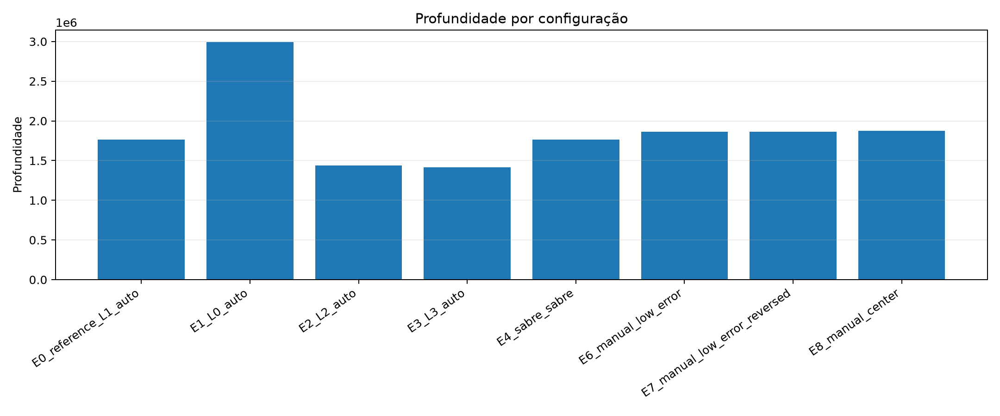
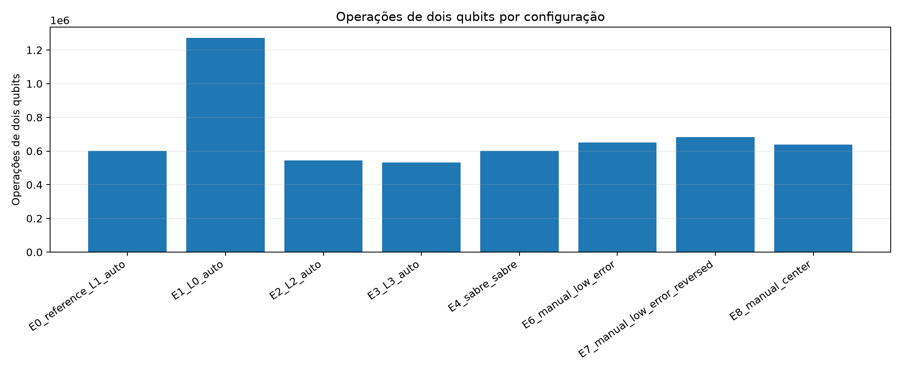

# shor no fakeaachen

projeto da disciplina de computação quântica. o trabalho compara estratégias de transpilação do circuito de busca de ordem de shor usando o backend simulado FakeAachen do Qiskit.

o circuito lógico e a instância matemática são mantidos iguais em todos os experimentos. o que muda é a configuração do transpiler.

## instância

| item | valor |
|---|---:|
| módulo | N = 77 |
| base | a = 30 |
| qubits de contagem | 14 |
| qubits de alvo | 7 |
| total de qubits lógicos | 21 |
| seed do transpiler | 42 |
| backend | FakeAachen |

a referência E0 usa `optimization_level=1` e layout automático, sem `initial_layout` manual.

## resultado principal

entre os experimentos concluídos, E3 (`optimization_level=3`, layout automático) teve os menores valores de profundidade, operações totais e operações 2Q, além do melhor valor de `log10(proxy)`.

| métrica | E0 · referência | E3 |
|---|---:|---:|
| profundidade | 1.765.950 | 1.412.349 |
| operações totais | 2.519.962 | 2.117.589 |
| operações 2Q | 602.131 | 531.587 |
| qubits físicos ativos | 21 | 24 |
| tempo de transpilação | 4,22 s | 11,19 s |
| log10(proxy) | -444,635 | -426,295 |

em relação a E0, E3 reduziu a profundidade em 20,02%, as operações totais em 15,97% e as operações 2Q em 11,72%. o tempo de transpilação aumentou.

a proxy é uma aproximação baseada nos erros disponíveis no snapshot e supõe independência entre instruções. ela não representa a probabilidade real de fatoração correta.

## experimentos

| id | configuração | situação |
|---|---|---|
| E0 | nível 1, layout automático | concluído · referência |
| E1 | nível 0, layout automático | concluído |
| E2 | nível 2, layout automático | concluído |
| E3 | nível 3, layout automático | concluído |
| E4 | layout SABRE e roteamento SABRE | concluído |
| E5 | layout DENSE e roteamento BASIC | pulado · sem métricas |
| E6 | layout manual em região conectada de menor custo estimado | concluído |
| E7 | mesma região de E6 com mapeamento invertido | concluído |
| E8 | layout manual em região central | concluído |

E5 foi mantido no CSV, mas não produziu métricas porque a execução anterior foi encerrada pelo sistema operacional. não foram estimados valores para esse experimento.

## backend

o snapshot local do FakeAachen contém 156 qubits físicos e 176 conexões não direcionadas. as portas principais são `rz`, `sx`, `x`, `cz` e `id`.

| parâmetro | mediana do snapshot |
|---|---:|
| erro de porta 1Q | 0,000159 |
| erro de porta 2Q | 0,001535 |
| erro de leitura | 0,007385 |
| T1 | 232,35 µs |
| T2 | 255,43 µs |

esses valores vêm do FakeProvider instalado no ambiente de execução. não são calibração ao vivo nem dados de uma QPU física.


## gráficos

os gráficos são gerados por `otimizar.py`. E3 recebe um destaque rosa discreto; os outros experimentos usam tons neutros.





os demais gráficos ficam na pasta `resultados/`: operações totais, tempo de transpilação e proxy.

## validação

a simulação ideal NumPy do circuito lógico, com 1.024 shots e seed 42, recuperou o período 30 e os fatores 7 e 11. isso valida o fluxo lógico de referência, não o circuito Aer transpilado.

a simulação MPS compactada de E3 teve 975 resultados distintos em 1.024 shots e uma distribuição muito mais dispersa que a simulação lógica ideal. mesmo com a recuperação do período no pós-processamento, esse resultado é exploratório e inconclusivo.

a simulação ruidosa disponível tem apenas 8 shots e não recuperou período ou fatores. essa amostra não permite estimar uma taxa de sucesso. a simulação Aer de E0 não foi concluída; portanto, não existe comparação estatística equivalente E0/E3.

## arquivos

| arquivo | conteúdo |
|---|---|
| `shor.py` | fluxo principal de fatoração |
| `quantum.py` | circuito de busca de ordem e simulação NumPy |
| `classical.py` | rotinas clássicas de apoio |
| `backends.py` | execução em Aer e FakeProvider |
| `resources.py` | estimativas de recursos |
| `otimizar.py` | caracterização, transpilação, métricas e gráficos |
| `validar.py` | validação lógica e auditoria estrutural |
| `validar_aer.py` | simulação MPS compactada e modelo ruidoso simplificado |
| `relatorio.md` | relatório completo do trabalho |
| `resultados/` | CSVs, JSONs, circuitos, gráficos e evidências |

a origem dos arquivos-base e as alterações realizadas estão descritas em `origem.md`.

## instalação

recomendado: Python 3.12.

```bash
python3.12 -m venv .venv
source .venv/bin/activate
python -m pip install --upgrade pip
python -m pip install -r requirements.txt
```

## execução

rodar a transpilação dos experimentos, mantendo E5 como pulado:

```bash
python otimizar.py --skip-experiment E5_dense_basic
```

retomar a execução usando as linhas concluídas do CSV:

```bash
python otimizar.py --skip-experiment E5_dense_basic --resume
```

rodar a validação lógica e a auditoria dos resultados já salvos:

```bash
python validar.py --shots 1024 --seed 42
```

exemplo de execução local do fluxo de shor:

```bash
python shor.py 77 --mode local --quantum --base 30 --shots 1024 --seed 42
```

as simulações Aer podem exigir bastante memória e tempo. os parâmetros MPS e o modelo de ruído simplificado devem ser informados ao interpretar seus resultados.

## observações

os resultados se limitam ao snapshot FakeAachen, à seed 42, às versões registradas em `resultados/versions.json` e à instância N=77, a=30. este circuito é uma demonstração didática e não permite inferir a viabilidade de fatoração de chaves RSA reais.
