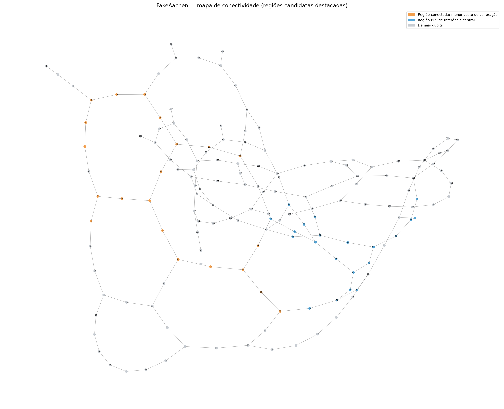
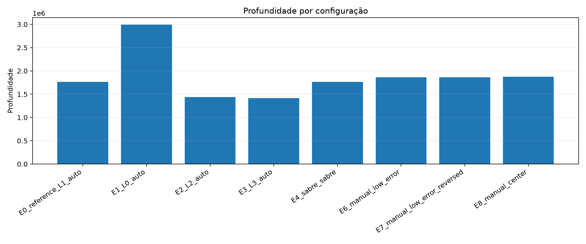

# shor no fakeaachen

estudo experimental de transpilação do circuito de busca de ordem do algoritmo de shor, usando o backend simulado **FakeAachen** do Qiskit.

o foco é comparar estratégias de otimização, layout e roteamento sem alterar a instância matemática nem a implementação lógica do circuito.

## objetivo

avaliar como diferentes configurações de transpilação afetam:

- profundidade do circuito;
- número total de operações;
- operações de dois qubits (2Q);
- mapeamento de qubits lógicos em qubits físicos;
- tempo de transpilação;
- proxy de fidelidade baseada nos erros disponíveis no target.

## instância experimental

| parâmetro | valor |
|---|---:|
| módulo | (N = 77) |
| base | (a = 30) |
| qubits de contagem | 14 |
| qubits de alvo | 7 |
| qubits lógicos | 21 |
| seed do transpiler | 42 |
| backend | FakeAachen |

a referência **E0** utiliza `optimization_level=1` e não define `initial_layout` manual. todas as configurações mantêm (N=77) e (a=30).

## resultado principal

entre os experimentos concluídos, **E3 (optimization_level=3, layout automático)** apresentou a melhor combinação dos indicadores estruturais avaliados.

| métrica | E0 · referência | E3 · melhor resultado estrutural |
|---|---:|---:|
| profundidade | 1.765.950 | 1.412.349 |
| operações totais | 2.519.962 | 2.117.589 |
| operações 2Q | 602.131 | 531.587 |
| qubits físicos ativos | 21 | 24 |
| tempo de transpilação | 4,22 s | 11,19 s |
| log10(proxy) | -444,635 | -426,295 |

em relação a E0, E3 reduziu a profundidade em **20,02%**, as operações totais em **15,97%** e as operações 2Q em **11,72%**. o tempo de transpilação, porém, aumentou.

a proxy é uma aproximação multiplicativa baseada nos erros de instrução disponíveis no snapshot. ela supõe independência entre erros e não representa a probabilidade real de fatoração correta. use o campo `log10_fidelity_proxy_independent_errors` para comparação; o produto direto pode sofrer underflow.

## experimentos

| id | configuração | status |
|---|---|---|
| E0 | nível 1, layout automático | concluído · referência |
| E1 | nível 0, layout automático | concluído |
| E2 | nível 2, layout automático | concluído |
| E3 | nível 3, layout automático | concluído |
| E4 | layout SABRE e roteamento SABRE | concluído |
| E5 | layout DENSE e roteamento BASIC | pulado · sem métricas |
| E6 | layout manual em região conectada de menor custo estimado | concluído |
| E7 | mesmo subconjunto de E6, associação invertida | concluído |
| E8 | layout manual em região central | concluído |

E5 foi mantido no registro experimental, mas não produziu métricas porque a execução anterior foi encerrada pelo sistema operacional. nenhum valor foi estimado para esse caso.

## caracterização do backend

o snapshot local registra:

- 156 qubits físicos e 176 conexões não direcionadas;
- portas principais: `rz`, `sx`, `x`, `cz` e `id`;
- erro mediano 1Q: 0,000159;
- erro mediano 2Q: 0,001535;
- erro mediano de leitura: 0,007385;
- T1 mediano: aproximadamente 232,35 µs;
- T2 mediano: aproximadamente 255,43 µs.

esses valores pertencem ao snapshot do FakeProvider. não são calibração em tempo real nem execução em uma QPU física.

### topologia



### métricas de transpilação




os gráficos são gerados por `shor_otimizado.py`. E3 é destacado com rosa suave para facilitar a leitura, sem alterar os dados.

## validação e limites

- **circuito lógico:** a simulação ideal NumPy, com 1.024 shots e seed 42, recuperou o período (r=30) e os fatores 7 e 11. essa etapa valida o fluxo lógico de referência, não o circuito Aer transpilado.
- **E3 com MPS:** a simulação compactada produziu 975 resultados distintos em 1.024 shots. apenas 6 shots ficaram a até uma unidade de contagem dos picos ideais esperados. apesar de o pós-processamento ter recuperado (r=30) e os fatores, a distribuição ficou muito dispersa; o resultado é exploratório e inconclusivo.
- **E3 com ruído:** a amostra disponível contém apenas 8 shots, sem recuperação de período ou fatores. é insuficiente para estimar uma taxa de sucesso.
- **comparação E0/E3:** a simulação Aer de E0 não foi concluída. não há comparação estatística equivalente entre os circuitos transpilados.

o modelo ruidoso simplificado utiliza canais depolarizantes e erro simétrico de leitura derivados do snapshot. não representa integralmente T1/T2, crosstalk, leakage, drift ou os custom noise passes do backend.

## estrutura do projeto

| arquivo | finalidade |
|---|---|
| `shor_original.py` | fluxo de fatoração e pós-processamento |
| `shor_quantum.py` | circuito de busca de ordem e simulação lógica NumPy |
| `shor_classical.py` | rotinas clássicas de apoio |
| `shor_otimizado.py` | caracterização, transpilação, métricas e gráficos |
| `shor_backends.py` | integração com os executores de simulação |
| `shor_resources.py` | estimativas e verificações de recursos |
| `validacao_reduzida_fakeaachen.py` | validação lógica e auditoria estrutural |
| `validacao_aer_compacta_ruido.py` | simulação MPS compactada com modelo ruidoso simplificado |
| `resultados_fakeaachen/resultados.csv` | métricas completas dos experimentos |
| `resultados_fakeaachen/backend_snapshot.json` | resumo do snapshot do backend |
| `relatorio_final.md` | relatório textual completo |

## ambiente registrado

- Python 3.12.0
- Qiskit 2.6.2
- Qiskit Aer 0.18.4
- qiskit-ibm-runtime 0.52.1
- NumPy 2.5.5
- Matplotlib 3.11.2
- NetworkX 3.7

as versões exatas estão em `resultados_fakeaachen/versions.json`. as faixas de dependências estão em `requirements.txt`.

## reprodução

criar e ativar o ambiente:

```bash
python3.12 -m venv .venv
source .venv/bin/activate
python -m pip install --upgrade pip
python -m pip install -r requirements.txt
```

executar os experimentos, mantendo E5 como pulado:

```bash
python shor_otimizado.py --skip-experiment E5_dense_basic
```

retomar a partir das linhas `status=ok` já gravadas:

```bash
python shor_otimizado.py --skip-experiment E5_dense_basic --resume
```

regerar a validação lógica e a auditoria estrutural:

```bash
python validacao_reduzida_fakeaachen.py --shots 1024 --seed 42
```

## limitações do estudo

os resultados se limitam ao snapshot FakeAachen, às versões registradas, à seed 42 e à instância (N=77, a=30). o circuito é uma demonstração didática de busca de ordem e não permite inferir a viabilidade de fatoração de chaves criptográficas reais. profundidade, contagem de portas e proxy de erros são indicadores estruturais; não substituem uma estimativa estatística de sucesso em hardware.
